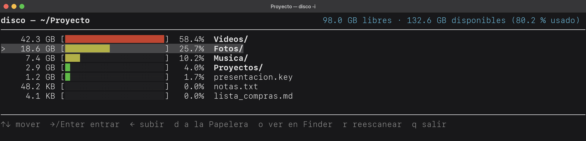
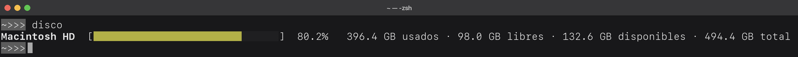
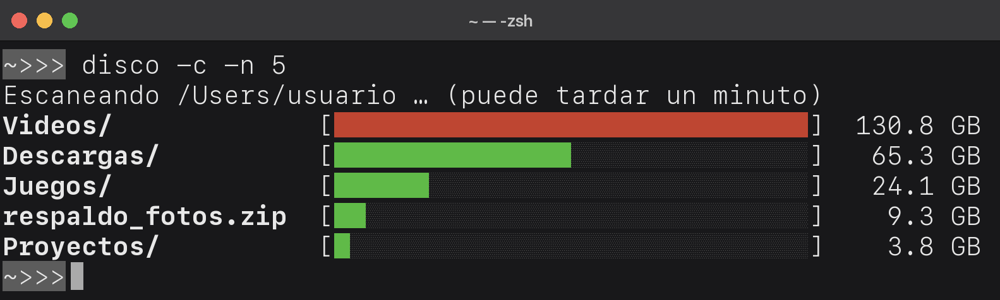

# disco

**Explora tu disco desde la terminal y manda a la Papelera lo que ya no necesitas.**
Compatible con macOS, Linux y Windows.

Corre `disco -i` y navega tus carpetas ordenadas de la más pesada a la más ligera:
entras, ves qué se está comiendo el espacio y lo mandas a la Papelera sin salir de la
terminal. También puedes ver rápido el espacio libre de tus discos (`disco`) o lo más
pesado de un lugar, carpetas y archivos (`disco -c`).

La forma principal de usarlo, corriendo `disco -i`, aqui navegas con las teclas indicadas en la imagen:



Además puedes correr directo `disco` para obtener el uso de todos los discos del SO:



No olvidar `disco -c` o `disco -c -n 5` para obtener las carpetas/archivos mas pesados del directorio



## Requisitos

- **Python 3.8 o más nuevo.**
- **macOS 14 o más nuevo**, **cualquier Linux** o **Windows 10/11**.
- En Windows, usa **Python 3.13** (`py -3.13` en los comandos de abajo). El modo
  interactivo necesita `windows-curses`, que todavía no tiene versión para Python más
  nuevo; con 3.13, pip lo instala solo. `py --list` te dice qué versiones tienes; si
  no tienes la 3.13, bájala de [python.org](https://www.python.org/downloads/windows/).

## Instalación

Con `pip`, que instala el comando `disco` para que lo uses desde cualquier carpeta.

**macOS y Linux** (en Debian/Ubuntu, instala antes `sudo apt install git python3-pip`)

```sh
python3 -m pip install --user git+https://github.com/msucedo/disco
```

**Windows** (en PowerShell o en Terminal; necesitas [Python](https://www.python.org/downloads/)
y [Git](https://git-scm.com/download/win))

```powershell
py -3.13 -m pip install --user git+https://github.com/msucedo/disco
```

Para empezar, explora tu carpeta personal:

```sh
disco -i ~
```

Si después la terminal no encuentra `disco`, agrega a tu `PATH` la carpeta donde pip
instala los comandos: `~/.local/bin` en Linux, `~/Library/Python/3.X/bin` en macOS
(cambia `3.X` por tu versión de Python). En Windows, pip te muestra la ruta en un
aviso al terminar de instalar.

Si pip responde con el error `externally-managed-environment` (pasa con el Python de
Homebrew y en Debian/Ubuntu recientes), instálalo en un entorno virtual (en
Debian/Ubuntu, instala antes `sudo apt install python3-venv`):

```sh
python3 -m venv ~/.venvs/disco
~/.venvs/disco/bin/pip install git+https://github.com/msucedo/disco
```

y agrega `~/.venvs/disco/bin` a tu `PATH`. O, si prefieres, añade
`--break-system-packages` al comando de instalación.

### Actualizar

**macOS y Linux**

```sh
python3 -m pip install --user --upgrade git+https://github.com/msucedo/disco
```

**Windows**

```powershell
py -3.13 -m pip install --user --upgrade --force-reinstall git+https://github.com/msucedo/disco
```

`--force-reinstall` hace que baje lo último aunque el número de versión no haya
cambiado.

### Sin instalarlo

También puedes descargarlo y correrlo directo.

**macOS y Linux**

```sh
git clone https://github.com/msucedo/disco
cd disco
python3 disco.py -i
```

**Windows**

```powershell
py -3.13 -m pip install --user windows-curses
git clone https://github.com/msucedo/disco
cd disco
py -3.13 disco.py -i
```

## Uso

### Modo interactivo (`disco -i`)

Al abrirlo, `disco` mide la carpeta completa y te muestra lo que hay adentro, de lo
más pesado a lo más ligero. Sin `RUTA`, empieza en la carpeta donde estás parado
(`cd ~/Downloads && disco -i` abre `~/Downloads`).

Con `←` puedes subir más allá de la carpeta de inicio: desde tu carpeta personal
llegas a la que contiene a todos los usuarios (`/Users` en macOS, `/home` en Linux,
`C:\Users` en Windows), y de ahí a la raíz del disco. Al subir, `disco` solo mide lo
nuevo y no vuelve a medir lo que ya tenía, así que es rápido.

| Tecla | Acción |
|---|---|
| `↑` `↓` (o `k` `j`) | Moverse por la lista |
| `→` / `Enter` (o `l`) | Entrar a la carpeta |
| `←` (o `h`) | Volver a la carpeta anterior; en la carpeta de inicio, sube a la que la contiene |
| `d` | Mandar a la Papelera lo seleccionado (pide confirmación) |
| `o` | Mostrarlo en el Finder, el Explorador de Windows o el administrador de archivos de Linux |
| `r` | Volver a medir la carpeta actual |
| `v` | Vaciar la Papelera (aparece cuando mandaste algo; pide confirmación) |
| `q` | Salir |

Cuando mandas algo a la Papelera, abajo aparece en amarillo cuánto espacio vas a
liberar. Ese espacio **no se libera hasta que vacías la Papelera**, con `v` o desde
tu sistema.

Cada cosa que mandas a la Papelera queda anotada en un historial. Con `disco -s` ves
cuánto llevas:

```
$ disco -s
Con disco has liberado 3.2 GB hoy y 52.1 GB desde que lo instalaste.
```

El historial es un archivo de texto con una línea por cosa (fecha, tamaño y ruta).
Lo puedes abrir para ver qué borraste:

- macOS: `~/Library/Application Support/disco/historial.tsv`
- Linux: `~/.local/state/disco/historial.tsv`
- Windows: `%LOCALAPPDATA%\disco\historial.tsv`

### Otros comandos

| Comando | Qué hace |
|---|---|
| `disco -i [RUTA]` | Navegador interactivo para explorar `RUTA` y mandar cosas a la Papelera (por defecto, la carpeta actual). |
| `disco` | Espacio de cada disco conectado: usado, libre, disponible (solo macOS) y total. |
| `disco -c [RUTA]` | Lo más pesado (carpetas y archivos) dentro de `RUTA` (por defecto, la carpeta actual). |
| `disco -c RUTA -n 5` | Igual, pero solo las 5 cosas más pesadas (por defecto, 15). |
| `disco --json` | La salida en JSON, para usarla en scripts (funciona con `disco` y `disco -c`). |
| `disco -s` | Cuánto has liberado con `disco` hoy y desde que lo instalaste (cuenta lo que mandas a la Papelera con `d`). |
| `disco -w 50` | Cambia el ancho de las barras (por defecto, 30). |
| `disco -h` | Ayuda con todas las opciones. |
| `disco -V` | Versión instalada. |

`disco -i` y `disco -c` pueden tardar un minuto en carpetas grandes, porque tienen que
medir todo lo que hay adentro. En Windows tardan un poco más, porque no existe `du` y
`disco` lo mide por su cuenta.

En Windows, `~` también funciona: `disco -i ~\Downloads`.

## ¿Es seguro?

- **`d` no borra nada para siempre:** solo lo manda a la Papelera (la Papelera de
  reciclaje en Windows), y lo puedes recuperar desde ahí.
- **Las carpetas del sistema están protegidas.** `disco` no te deja mover la raíz de
  un disco ni, por ejemplo:
  - macOS: `/System`, `/Applications`, `/Library`, tu `~/Library` completa.
  - Linux: `/usr`, `/etc`, `/boot`, `/var`, `/home`, tus `~/.config` y
    `~/.local/share` completas.
  - Windows: `C:\Windows`, `Program Files`, `ProgramData`, `C:\Users`, tu `AppData`
    completa.
- **Aviso para datos de apps:** si lo que vas a mover está dentro de `~/Library`
  (macOS, fuera de `Caches`), `~/.config` o `~/.local/share` (Linux) o `AppData`
  (Windows, fuera de `Temp`), te avisa en rojo de que esa app puede perder datos o su
  configuración.
- **`v` vacía TODA la Papelera,** no solo lo que mandaste con `disco`, y eso no se
  puede deshacer. Por eso te pide confirmación.
- **Ojo con las carpetas ocultas en macOS:** lo que empieza con punto (como
  `~/.ollama`) sigue oculto dentro de la Papelera, así que el Finder no lo muestra
  aunque esté ahí.
- **En Windows,** si algo es demasiado grande para la Papelera de reciclaje, Windows
  te pregunta antes de borrarlo para siempre.

## Permisos (solo macOS)

La primera vez que vacíes la Papelera con `v`, macOS te va a preguntar si tu terminal
puede controlar el Finder. Acepta: `disco` le pide al Finder que la vacíe, porque macOS
no deja que la terminal toque la Papelera directamente.

Si dices que no, puedes darle el permiso después en **Ajustes del Sistema →
Privacidad y seguridad → Automatización**.

## Libres vs. disponibles (solo macOS)

En macOS, `disco` muestra dos cifras, y es normal que no sean iguales:

- **Libres:** el espacio que está vacío ahora mismo. Es el mismo número que dan
  `df -h /` y `diskutil info /`.
- **Disponibles:** lo libre **más** lo que macOS puede borrar solo cuando le haga falta
  espacio (copias temporales del sistema, cachés, archivos de iCloud que se pueden
  volver a descargar). Es lo que macOS les dice a las apps que pueden usar.

El Finder muestra "disponible" con un cálculo propio, así que su número puede ser un
poco distinto del de `disco`. En Linux y Windows no existe esa diferencia, así que solo
se muestra "libres".

## Desinstalar

**macOS y Linux**

```sh
python3 -m pip uninstall disco
```

**Windows**

```powershell
py -3.13 -m pip uninstall disco
```

Si lo instalaste en un entorno virtual, basta con borrar `~/.venvs/disco`.

## Licencia

[MIT](LICENSE) © msucedo
